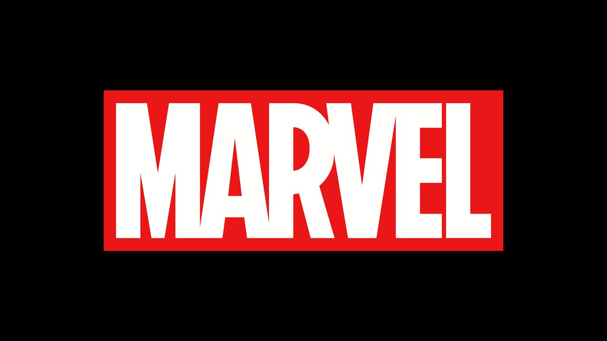
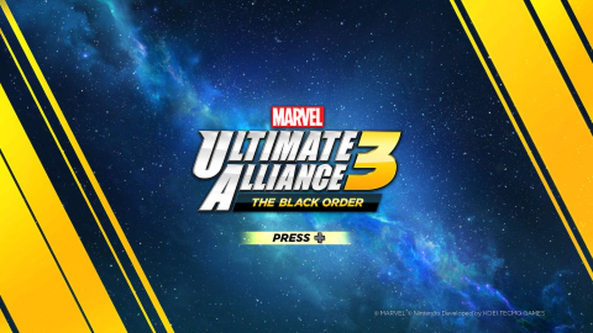
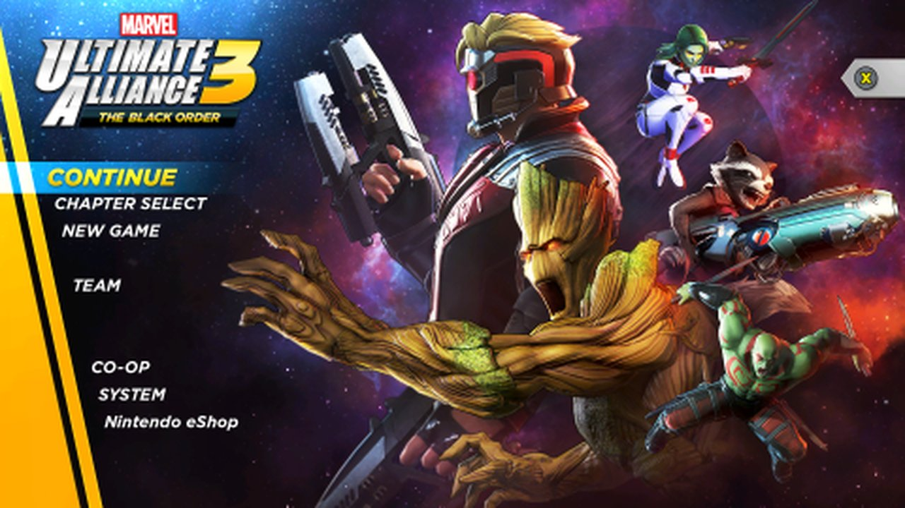
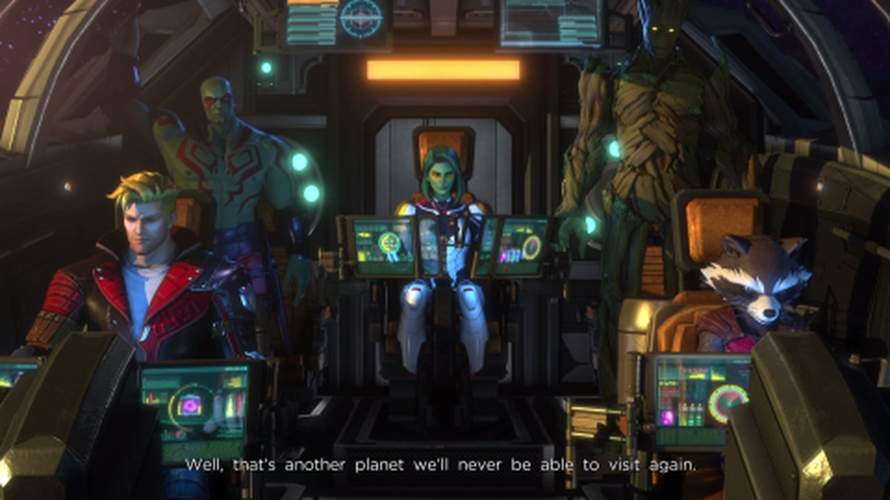
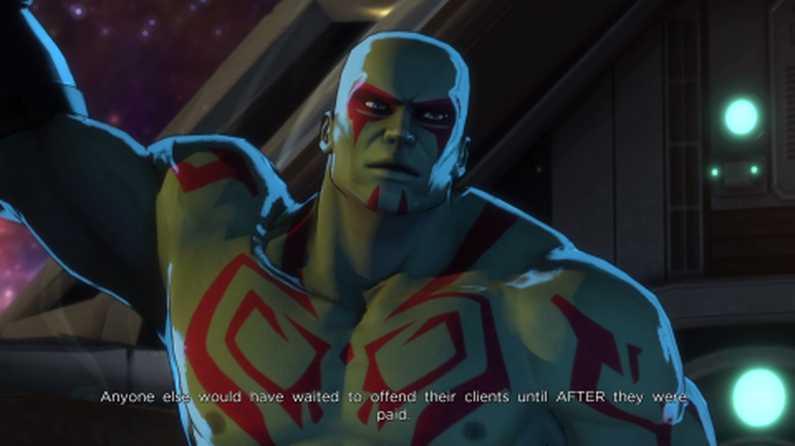
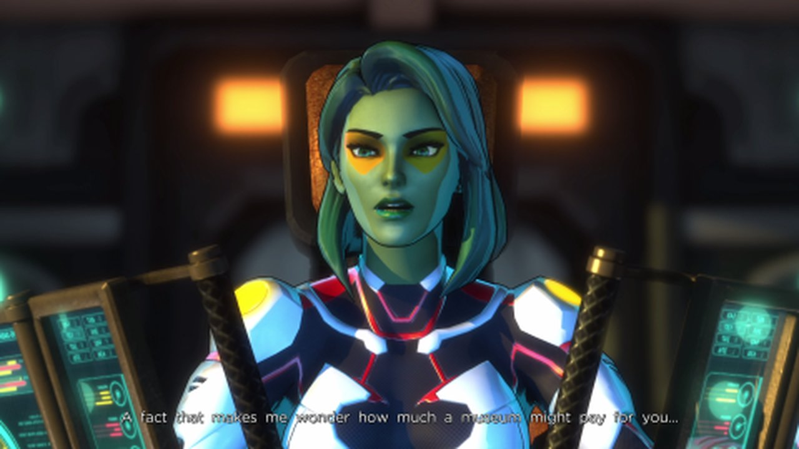
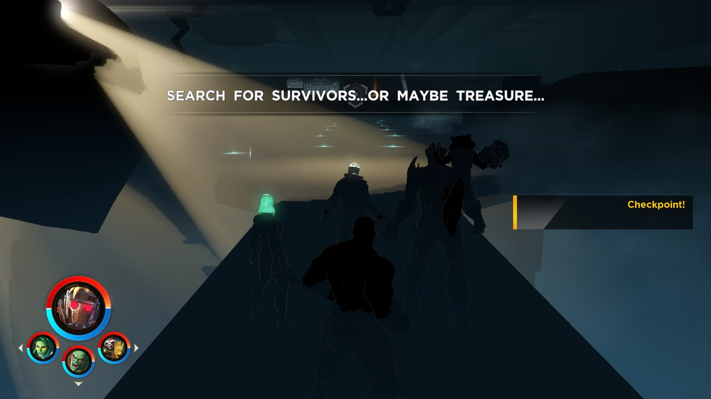
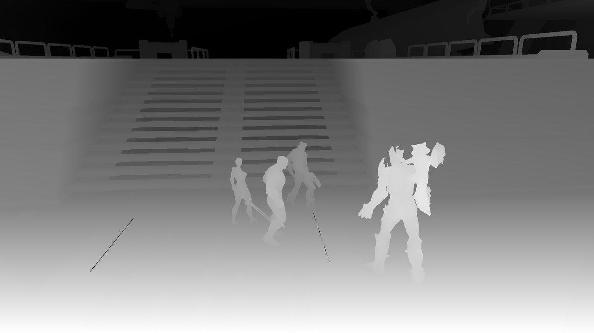

# MUA3 Recomp

A static recompilation of *Marvel Ultimate Alliance 3: The Black Order* (Nintendo Switch) into a native x86-64 Windows
executable. The game's ARM64 code is turned into C and compiled for PC; this is not an emulator.

> [!WARNING]
> **This project was made by AI.** Nearly all of the code, the porting work and this documentation were written by an
> AI coding agent (Claude Code, by Anthropic) at the repository owner's request; the owner tested the builds on their
> own PC.
>
> **It is based on [totk-pc-recomp](https://github.com/valentderah/totk-pc-recomp)** by Valiantsin Dzerakh (the *Tears
> of the Kingdom* recomp). The lifter, the runtime and almost everything else come from there; this repository adapts
> it to another game. The original credits and licenses still apply (see [Credits](#credits)).
>
> **The game is not playable yet.** See the status below.

> [!IMPORTANT]
> **No game files are included.** You need your own copy of the game, dumped from your own console. Instructions for
> obtaining those files will not be provided.
>
> The game is built from your files on your machine, so the result contains the game. It is for your own use. Do not
> share the build folder.

## Status

| Stage | State |
| --- | --- |
| Recompilation (104,614 functions, 0 unsupported instructions) | ✅ |
| Boot, initialisation, audio, gamepad, user account and save data | ✅ |
| Marvel logo, title screen and main menu | ✅ |
| H.264 movies (opening cutscene with sound and subtitles) | ✅ |
| Reaching gameplay (first stage, HUD, checkpoint) | ✅ about 30 fps |
| Lit 3D scene (characters and level) | ❌ almost black |
| Actually playing, finishing the game | ❌ untested |
| DLC (Expansion Pass), online, Linux | ❌ |

### Logo, title screen and menu







### Opening cutscene

The new-game movie plays to the end with sound and subtitles (decoded with Windows Media Foundation).







### Gameplay (the current problem)

The game enters the first stage: the HUD, team portraits, objective text and checkpoint show up, but the scene is dark
and the characters are silhouettes.



The depth buffer of the same frame shows that the geometry is there, in the right place:



What is known so far: the G-buffer draws are `DrawElementsIndirect` calls whose arguments should be filled in by a
culling step, and they all arrive with an index count of 0. Nothing is drawn into the colour targets, so the lighting
pass multiplies by zero. The CPU only initialises that block; what should fill it has not been found yet. Details,
ruled-out hypotheses and next steps are in [docs/mua3-port.md](docs/mua3-port.md) (in Portuguese).

## What was adapted from TotK Recomp

- An `mua3` game profile (title ids, versions, expected hashes) in [tools/game_profile.py](tools/game_profile.py) and
  [tools/data/mua3](tools/data/mua3); `build_game.py --game mua3` produces `mua3.exe`, `mua3.ini` and `logs\mua3.log`.
- Boot with MUA3's older SDK (`nn::init::Start` with 2 callbacks); TotK-specific patches turned off.
- Offline answers for network services (sockets, BCAT, friends, shop), account, save data, empty DLC list, the older
  hid API, `audout`.
- NVN to Vulkan: per-stage programs, indirect draws, alpha test, compute shared memory size, textures bound through
  image handles, and many newly implemented NVN calls.
- H.264 + AAC movie decoding (`runtime/movie_codec_win.c`), with SPS/PPS read from the MP4's `avcC`.
- Shader translator (from Ryujinx) with NaN/Inf fixes and Maxwell's FMZ and NaN-aware min/max/clamp behaviour.
- A function profiler (`TOTK_FNPROF`) and a write tracer to investigate the dark scene.

Fixes were also brought over from other open recomps: Cadence of Hyrule, Astral Chain, Xenoblade Chronicles X, Fire
Emblem: Three Houses and Pokopia (GPL code was only read for behaviour and rewritten, never copied).

## Building from source

Windows only, game version **4.0.1** only (base game 1.0.0 + the 4.0.1 update). There is no installer or release yet.

Requirements: MSYS2 UCRT64 (clang/lld, ninja, SDL3, opus, libvpx, zstd, Vulkan headers), Python 3.12 and 3.14, the
.NET SDK and Visual Studio Build Tools (for the shader translator), a GPU with Vulkan 1.3 and about 60 GB free.

You need the base game and the update (NSP or NSZ) and your console's `prod.keys`. From the repository folder:

```bash
.venv-py314\Scripts\python -I tools\mua3_extract.py --base base.nsp --update update.nsp --keys prod.keys
.venv\Scripts\python recomp\gen.py --exefs build\extracted\upd\exefs --out generated\upd --modules main,subsdk0,subsdk1,sdk
.venv\Scripts\python tools\build_game.py --game mua3 --version upd --gen generated\upd --out build\upd --exefs build\extracted\upd\exefs --romfs build\extracted\upd\romfs --expected build\extracted\expected-upd.json
build\upd\mua3.exe
```

The general process is the original project's ([docs/building.md](docs/building.md)). Everything the build writes
stays under `build\` and `generated\`, which git ignores. Run `tools/check_content.py --staged` before every commit so
that no game content enters the repository.

## Credits

- [totk-pc-recomp](https://github.com/valentderah/totk-pc-recomp) by Valiantsin Dzerakh: the base of this whole project
- The projects totk-pc-recomp builds on, listed with their licenses in [THIRD_PARTY_NOTICES.md](THIRD_PARTY_NOTICES.md):
  LAS Recomp, MacNativeGames, Ryujinx, deko3d, hactool, SDL 3, Dear ImGui, AMD FSR 1, Vulkan Memory Allocator,
  libopus, libvpx, Zstandard, bcdec, Switchbrew and the Switch homebrew community
- Fixes ported from other recomps: cadence-pc-recomp, astral-chain-pc-recomp, xcx-recomp, fe3h-recomp and
  switch2-recomp (Pokopia)

## License

The project's code is under the original project's [MIT License](LICENSE); third-party code keeps its own license
([THIRD_PARTY_NOTICES.md](THIRD_PARTY_NOTICES.md)). The license grants nothing for the game.

An independent, non-commercial fan project, not affiliated with or endorsed by Nintendo, Marvel, Disney or Koei Tecmo /
Team Ninja. *Marvel Ultimate Alliance 3* and its characters are trademarks of Marvel; *Nintendo Switch* is a trademark
of Nintendo. The screenshots above were taken from the game running from the owner's own copy and only document the
port's progress.
